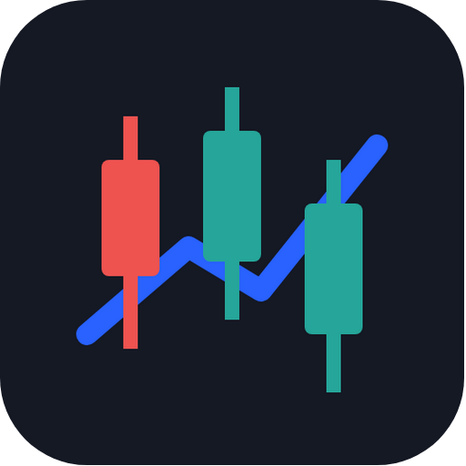
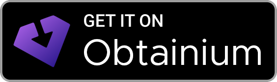
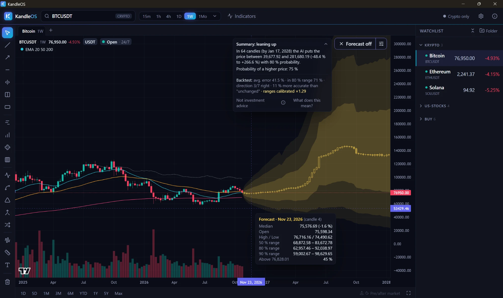

<p align="center"></p>

<h1 align="center">KandleOS</h1>

<p align="center">
  <a href="https://github.com/Sined1010/kandleos/releases/latest"></a>
  
  <a href="LICENSE"></a>
</p>

A fast, local desktop app for technical chart analysis on **Windows and Linux**, with a built-in
AI price forecast (Chronos-2) that runs entirely on your computer. An Android app brings charts, watchlist,
drawings and price alarms to your phone, and paired with your PC also the AI forecast and analysis.

<p align="center">
  <a href="https://github.com/Sined1010/kandleos/releases/latest"></a>
  <a href="https://github.com/Sined1010/kandleos/releases/latest"></a>
  <a href="https://apps.obtainium.imranr.dev/redirect?r=obtainium://app/%7B%22id%22%3A%22io.github.sined1010.kandleos%22%2C%22url%22%3A%22https%3A%2F%2Fgithub.com%2FSined1010%2Fkandleos%22%2C%22author%22%3A%22Sined1010%22%2C%22name%22%3A%22KandleOS%22%2C%22additionalSettings%22%3A%22%7B%5C%22apkFilterRegEx%5C%22%3A%5C%22KandleOS-.*%5B.%5Dapk%5C%22%7D%22%7D"></a>
</p>


https://github.com/user-attachments/assets/08937b61-0954-4af9-a7fc-89ec120ba1f5




## Why KandleOS?

- **Local and private:** no account, no cloud, no telemetry. Your watchlist and drawings stay on your computer
- **An AI forecast that tells you how good it is:** instead of a single target price you get uncertainty ranges,
  a backtest on past data and a comparison against simply assuming "the price stays the same". If that simple
  guess would have been closer, KandleOS says so
- **Organize your watchlist your way:** as many folders as you like, as a list or as folder tiles, with drag & drop, your own names and sorting by daily change
- **See what insiders do:** board members' buys and sells (BaFin, Finnhub) right at their candle, off until you switch them on
- **Free and open source** (GPL-3.0), no subscription, no ads, no paid tier

## Features

- **Charts** with volume, live prices and candle sizes from 1 minute to 12 months, plus pre- and post-market prices and candles.
  Older candles load automatically as you scroll back (up to 10,000), and for US stocks a price line shows the pre-/post-market price.
  2h and 4h stock candles follow the exchange's session (e.g. 9:30 and 13:30 in New York), also across daylight saving changes.
  Switching back to a chart you opened before shows it at once while fresh prices load
- **Indicators:** SMA, EMA, triple EMA, Bollinger Bands, VWAP, Supertrend, RSI, MACD, Stochastic, ATR, with a legend in the chart showing their values
- **Drawing tools:** trend line, ray, horizontal/vertical line, channel, rectangle, text, Fibonacci retracement, extension, fan and time zones, Elliott waves (impulse, correction, triangle, W-X-Y, W-X-Y-X-Z), sine wave, measure. Each drawing can get its own color, text comes in five sizes
- **Saved charts:** save a symbol with its candle size and drawings under a name and load it again later, grouped by symbol and searchable
- **Watchlist** with folders, a list or folder view with tiles, drag & drop, "Move to …", renaming, market status and a right-click menu.
  The daily change shows as a colored pill, ⏰ marks symbols with an active alarm, each folder shows its average change,
  and you can sort by your own order, strongest, weakest or name (per device, your saved order stays untouched)
- **Up to 3 chart tabs**, full-screen mode (drawing works there too), symbol search by name, ticker, ISIN or WKN with filters for stocks, ETFs and crypto, company info with ISIN and WKN
- **AI forecast ([Chronos-2](https://huggingface.co/amazon/chronos-2)):** runs locally via ONNX, no cloud. Shows a 50/80/90 % fan or forecast candles instead of a single target price, a plain-language summary (direction, range, probability of a higher price) and a backtest so you can see how accurate past forecasts were
- **Forecast quality:** up to 30 backtests per forecast (older candles are loaded for them) show how often the price stayed inside
  the 90 % range and whether "higher price" calls were right. A local forecast archive settles your own forecasts once their time
  has passed and keeps a running track record per symbol and candle size
- **Optional in-depth analysis with [TradingAgents](https://github.com/TauricResearch/TradingAgents):** AI agents using your own API keys, or fully local with Ollama.
  The market analyst gets the daily Chronos-2 forecast with its track record, and the report compares the agents' decision with it
- **Insider deals in the chart:** buys and sells by board members (BaFin for German stocks, Finnhub for US stocks) as markers
  at their candle and as a list in the Events tab, with clusters, the delay until publication and a short context per deal.
  US stocks also list 8-K filings and company news. Off by default; the Events button switches them on
- **Back up your data:** export watchlist, drawings, saved charts and settings to one file, API keys only password-encrypted
- **Android app** with price alarms (in the app, in the background every 15 minutes, or as instant alarms every 15 seconds)
- **Pair your phone with your PC:** watchlist, drawings, saved charts and alarms stay in sync, alarms also show up on the PC,
  and the phone gets the AI forecast, its quality check and the TradingAgents analysis computed by your PC. Directly over
  your home network or VPN, end-to-end encrypted, no cloud
- English and German interface

## Download and installation

Download the installer for your system from the [Releases](https://github.com/Sined1010/kandleos/releases) page.

### Windows (10/11, x64)

Run `KandleOS-Setup-<version>.exe`. It installs for the current user without admin rights.

The installer is not code-signed, so Windows SmartScreen may warn you. Click **More info → Run anyway**.

### Linux (x64)

- **Debian, Ubuntu, Mint, Pop!_OS:** `sudo apt install ./KandleOS-<version>-amd64.deb`
- **Any distribution, no installation:** `chmod +x KandleOS-<version>-x86_64.AppImage`, then run it
- **tar.gz:**

```bash
tar xzf KandleOS-<version>-x64.tar.gz
bash KandleOS-<version>-x64/install.sh
```

The tar.gz installs to `~/.local/share/kandleos-app` and adds a launcher to the app menu and the desktop.
For Electron's sandbox the script asks for your `sudo` password once (recommended). If you skip it, KandleOS
runs without the sandbox and shows a warning.

To uninstall: `bash ~/.local/share/kandleos-app/install.sh --uninstall` (your data in `~/.config/kandleos` is kept).

### Android (8.0 or newer)

The Android app has charts, indicators, the watchlist with folders (as a list or folder tiles, with sorting and a
reorder mode), drawings, saved charts and insider events (**⋮ → Events**), plus price alarms that also fire in the
background.

Install `KandleOS-<version>.apk` from the Releases page, or let [Obtainium](https://github.com/ImranR98/Obtainium)
install and update it: add `https://github.com/Sined1010/kandleos` as a new app and set the APK filter to
`KandleOS-.*[.]apk`. Android asks once to allow installing apps from Obtainium (or your browser). Every APK is
signed with the same KandleOS key, so updates install over the previous version and keep your data.

**Pair it with your PC** to sync watchlist, drawings, saved charts and alarms, and to use the AI forecast and the
TradingAgents analysis on the phone (your PC computes them, so it needs to be on):

1. On the PC: **Settings → Pair a phone → Pair now**. On Windows, KandleOS asks once for admin rights to add its own
   firewall rule (`KandleOS-Handy-Kopplung`: only KandleOS, only TCP port 47321, only from your local network).
2. On the phone: scan the QR code in the KandleOS app (**⋮ → Pair with PC**) or with your camera app.

Phone and PC must be in the same Wi-Fi, or connected through a VPN (set the PC's VPN address under **Advanced**).
While pairing is on, closing the PC window keeps KandleOS running in the system tray, so sync and alarms go on.
Keep the PC and the phone on the same KandleOS version: if one of them stores data the other cannot read yet, sync
pauses and the phone asks you to update both, instead of losing drawings or alarms.

## Data sources

You choose the stock data source on first start; you can change it any time in the settings.

| Source | What | Key |
|---|---|---|
| [Binance](https://www.binance.com/) | Crypto prices and the list of tradable crypto pairs for the search | not needed |
| [Alpaca](https://alpaca.markets/) | US stocks and ETFs (recommended for US stocks) | your own free key. Use **paper trading keys**: KandleOS only reads market data, live keys would also allow trading |
| Yahoo Finance | Stocks worldwide, indices, commodities, pre-/post-market | not needed, opt-in |
| [Finnhub](https://finnhub.io/) | Optional real-time trades for US stocks, company info, and for US stocks insider deals, 8-K filings and company news in the Events tab | your own free key |
| [BaFin](https://portal.mvp.bafin.de/database/DealingsInfo/) | Insider dealings of German companies, last 12 months (Events tab, asked only with events switched on). Source: © Bundesanstalt für Finanzdienstleistungsaufsicht / www.bafin.de | not needed |
| [Deutsche Börse](https://www.cashmarket.deutsche-boerse.com/cash-en/trading/Tradable-Instruments-Xetra), [Wikidata](https://www.wikidata.org/) | ISIN and WKN in the company info (US stocks: computed from Alpaca's CUSIP); the Xetra list loads once a digit is typed into the search (Yahoo only) or, with events on, a German stock is opened; a German stock missing from it is looked up on Wikidata. With events on, Wikidata is also asked for the US listing (ADR) of a stock without an insider source | not needed |

**About Yahoo Finance:** Yahoo does not offer an official API for this. Like the open-source library yfinance,
KandleOS reads the publicly available data that Yahoo's own finance website loads. Yahoo Finance data is meant for
personal use, so this source is opt-in and only enabled after you confirm private use. It may stop working at any
time. KandleOS is not affiliated with, endorsed or vetted by Yahoo, Inc.; Yahoo! and Yahoo Finance are trademarks of
Yahoo, Inc.

API keys are stored encrypted with the operating system's key store (on Linux only with gnome-keyring or KWallet,
otherwise in a file readable only by you).

## AI forecast and analysis

- **Chronos-2 forecast:** on the first click KandleOS downloads a fixed version of the model (about 480 MB) from
  Hugging Face and verifies its SHA-256 checksum. After that, forecasts run offline on your CPU.
- **TradingAgents analysis (optional):** when you set it up, KandleOS downloads Python (via
  [uv](https://github.com/astral-sh/uv)) and TradingAgents into its own data folder, with all dependencies pinned
  by hash. Each analysis sends the symbol and the collected market and news data to the AI provider you choose,
  unless you use Ollama locally.

## Privacy

KandleOS collects no usage data and sends nothing to its author (no telemetry). Watchlist, drawings, settings and the
forecast archive stay on your computer (`%APPDATA%\kandleos` on Windows, `~/.config/kandleos` on Linux). To load prices the app connects
directly to the providers above, which see your IP address. The update check is off by default: if you turn it on,
KandleOS asks GitHub once a day for the latest version number (or when you click **Check for updates** in About);
nothing is downloaded or installed automatically. A paired phone talks to your PC directly over your local network or
VPN; every message is encrypted with a key that only the two devices know, and nothing goes through a server.
With events switched on (they are off by default), opening a German stock sends its ISIN to BaFin to load the insider deals of that company.
Details are in the app under **About KandleOS**.

## Not investment advice

KandleOS is a tool for technical analysis. Indicators, drawings, the forecast and AI-generated reports are aids,
**not investment advice** and no recommendation to buy or sell. Prices may be delayed, incomplete or wrong.
Use at your own risk.

## Building from source

Requires [Node.js](https://nodejs.org/) (tested with 24) and npm.

```bash
npm install
npm run dev
```

npm 11 does not run install scripts by default. If Electron is missing after `npm install`, run
`node node_modules/electron/install.js`.

| Task | Command |
|---|---|
| Tests | `npm test` |
| Type check | `npm run typecheck` |
| Windows installer | `npm run dist:win` |
| Linux tar.gz (also on Windows) | `npx electron-builder --linux tar.gz` (after `npm run licenses && npm run build`) |
| Linux AppImage/.deb (on Linux) | `bash linux/build-installer.sh` |
| Android APK (Windows, JDK 21 + Android SDK) | `npm run android:sync`, then `android/build-apk.cmd` (debug) |

Installers end up in `release/`.

## Security

Please do not report security issues as public issues; see [SECURITY.md](SECURITY.md).

## License

KandleOS is free software under the [GNU General Public License v3.0 or later](LICENSE).
Third-party licenses are listed in [resources/THIRD_PARTY_LICENSES.txt](resources/THIRD_PARTY_LICENSES.txt).

Charts: [TradingView Lightweight Charts™](https://www.tradingview.com/lightweight-charts/) (Apache-2.0).
Forecast model: [Amazon Chronos-2](https://huggingface.co/amazon/chronos-2) (Apache-2.0),
[ONNX export by sktime](https://huggingface.co/sktime/chronos2-onnx).
Optional analysis: [TradingAgents](https://github.com/TauricResearch/TradingAgents) by Tauric Research (Apache-2.0),
installed on demand together with Python (PSF License) and [uv](https://github.com/astral-sh/uv) (MIT/Apache-2.0).
All trademarks belong to their owners;
KandleOS is not affiliated with these companies.
