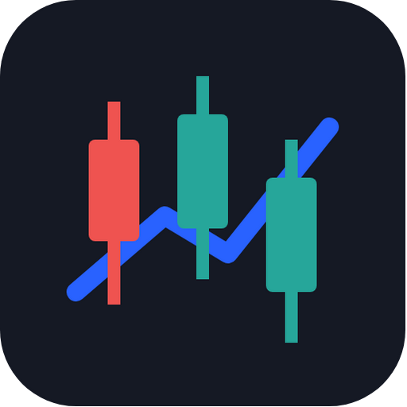
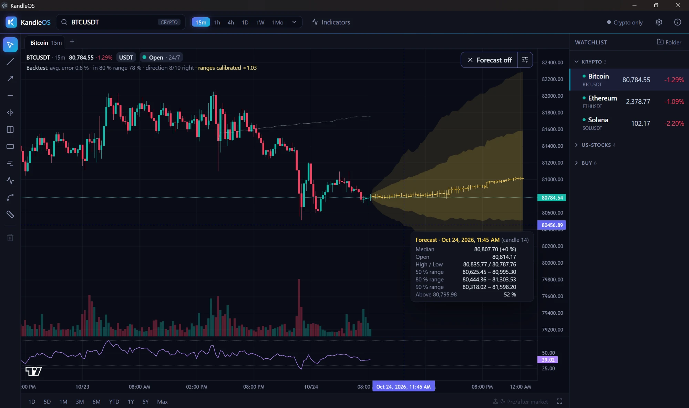

<p align="center"></p>

<h1 align="center">KandleOS</h1>

A fast, local desktop app for technical chart analysis on **Windows and Linux**, with a built-in
AI price forecast (Chronos-2) that runs entirely on your computer.



## Features

- **Charts** with volume, live prices and candle sizes from 1 minute to 12 months, plus pre- and post-market prices and candles
- **Indicators:** SMA, EMA, triple EMA, Bollinger Bands, VWAP, Supertrend, RSI, MACD, Stochastic, ATR
- **Drawing tools:** trend line, ray, horizontal/vertical line, channel, rectangle, Fibonacci, Elliott waves, measure
- **Watchlist** with folders, drag & drop, market status and a right-click menu
- **Up to 3 chart tabs**, full-screen mode, symbol search by name or ticker
- **AI forecast (Chronos-2):** runs locally via ONNX, no cloud. Shows a 50/80/90 % fan instead of a single target price, plus a backtest so you can see how accurate past forecasts were
- **Optional in-depth analysis with [TradingAgents](https://github.com/TauricResearch/TradingAgents):** AI agents using your own API keys, or fully local with Ollama
- English and German interface

## Download and installation

Download the installer for your system from the [Releases](https://github.com/Sined1010/kandleos/releases) page.

### Windows (10/11, x64)

Run `KandleOS-Setup-<version>.exe`. It installs for the current user without admin rights.

The installer is not code-signed, so Windows SmartScreen may warn you. Click **More info → Run anyway**.

### Linux (x64)

```bash
tar xzf KandleOS-<version>-x64.tar.gz
bash KandleOS-<version>-x64/install.sh
```

This installs to `~/.local/share/kandleos-app` and adds a launcher to the app menu and the desktop.
For Electron's sandbox the script asks for your `sudo` password once (recommended). If you skip it, KandleOS
runs without the sandbox and shows a warning.

To uninstall: `bash ~/.local/share/kandleos-app/install.sh --uninstall` (your data in `~/.config/kandleos` is kept).

## Data sources

You choose the stock data source on first start; you can change it any time in the settings.

| Source | What | Key |
|---|---|---|
| [Binance](https://www.binance.com/) | Crypto prices | not needed |
| [Alpaca](https://alpaca.markets/) | US stocks and ETFs (recommended for US stocks) | your own free key. Use **paper trading keys**: KandleOS only reads market data, live keys would also allow trading |
| Yahoo Finance | Stocks worldwide, indices, commodities, pre-/post-market | not needed, opt-in |
| [Finnhub](https://finnhub.io/) | Optional real-time trades for US stocks and company info | your own free key |

**About Yahoo Finance:** Yahoo does not offer an official API for this. Like the open-source library yfinance,
KandleOS reads the publicly available data that Yahoo's own finance website loads. Yahoo Finance data is meant for
personal use, so this source is opt-in and only enabled after you confirm private use. It may stop working at any
time. KandleOS is not affiliated with, endorsed or vetted by Yahoo, Inc.; Yahoo! and Yahoo Finance are trademarks of
Yahoo, Inc.

API keys are stored encrypted with the operating system's key store (on Linux only with gnome-keyring or KWallet,
otherwise in a file readable only by you).

## AI forecast and analysis

- **Chronos-2 forecast:** on the first click KandleOS downloads the model (about 480 MB) from Hugging Face and
  verifies its SHA-256 checksum. After that, forecasts run offline on your CPU.
- **TradingAgents analysis (optional):** when you set it up, KandleOS downloads Python (via
  [uv](https://github.com/astral-sh/uv)) and TradingAgents into its own data folder, with all dependencies pinned
  by hash. Each analysis sends the symbol and the collected market and news data to the AI provider you choose,
  unless you use Ollama locally.

## Privacy

KandleOS collects no usage data and sends nothing to its author (no telemetry). Watchlist, drawings and settings stay
on your computer (`%APPDATA%\kandleos` on Windows, `~/.config/kandleos` on Linux). To load prices the app connects
directly to the providers above, which see your IP address. Details are in the app under **About KandleOS**.

## Not investment advice

KandleOS is a tool for technical analysis. Indicators, drawings, the forecast and AI-generated reports are aids,
**not investment advice** and no recommendation to buy or sell. Prices may be delayed, incomplete or wrong.
Use at your own risk.

## Building from source

Requires [Node.js](https://nodejs.org/) (tested with 24) and npm.

```bash
npm install
npm run dev
```

npm 11 does not run install scripts by default. If Electron is missing after `npm install`, run
`node node_modules/electron/install.js`.

| Task | Command |
|---|---|
| Tests | `npm test` |
| Type check | `npm run typecheck` |
| Windows installer | `npm run dist:win` |
| Linux tar.gz (also on Windows) | `npx electron-builder --linux tar.gz` (after `npm run licenses && npm run build`) |
| Linux AppImage/.deb (on Linux) | `bash linux/build-installer.sh` |

Installers end up in `release/`.

## Security

Please do not report security issues as public issues; see [SECURITY.md](SECURITY.md).

## License

KandleOS is free software under the [GNU General Public License v3.0 or later](LICENSE).
Third-party licenses are listed in [resources/THIRD_PARTY_LICENSES.txt](resources/THIRD_PARTY_LICENSES.txt).

Charts: [TradingView Lightweight Charts™](https://www.tradingview.com/lightweight-charts/) (Apache-2.0).
Forecast model: Amazon Chronos-2 (Apache-2.0), ONNX export by sktime. All trademarks belong to their owners;
KandleOS is not affiliated with these companies.
